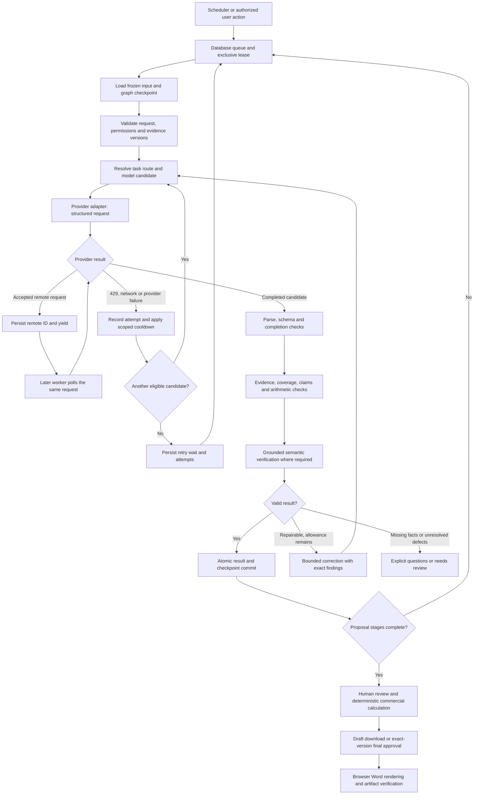

# Unified model execution and real proposal acceptance

Date: October 20, 2026. Owner-requested implementation plan.
Status: **planned; runtime implementation and hosted acceptance are separate deliverables**.
Baseline: application source `bd0cf5ed2b5bd3686c4b813d78f3ee00f14e736e`,
documentation source `56d2f77e77ddb3bcef819fff2ff318af6a7008bf`.

**ملخص:** نوحّد كل طلبات ونتائج الموديلات، ونضيف اختيار عدة موديلات لكل مهمة
مع الحفاظ على الـfailover. نستخدم LangGraph لإدارة خطوات التحقق والتصحيح
والاستكمال، وتبقى قاعدة البيانات مسؤولة عن الجدولة والصلاحيات ومنع التكرار.
أولوية القبول هي تنزيل عرض حقيقي ومراجع، مع السماح بالبدء دون تمبلت أو ملف
شركة. النواقص تتحول إلى أسئلة واضحة؛ لا نختلق شهادات أو خبرات أو أسعار.
هذه الوثيقة خطة تنفيذ، وليست إعلانًا بأن الرحلة الحية نجحت.

## 1. Relationship to the original project plans

This is an extension to the existing project, not a replacement roadmap.
The [original specification](IMPLEMENTATION_SPEC.txt) remains the historical
requirements baseline. Later Owner decisions in [DECISIONS.md](DECISIONS.md)
take precedence. [IMPLEMENTATION_CHECKLIST.md](IMPLEMENTATION_CHECKLIST.md)
remains the execution/status authority.

| Work package | Original milestone / checklist stage | Original acceptance requirements | Existing implementation to extend |
| --- | --- | --- | --- |
| P0: real RFP acceptance baseline | M4–M6; stages 2, 5, 6, 7 | AT12–AT21, AT23–AT24 | [Generation](../supabase/functions/_shared/generation.ts), [export QA](EXPORT_QA.md), [evaluation](EVALUATION.md) |
| P1: shared contracts and adapters | M3–M4; stages 3, 4, 5 | AT09–AT10, AT14, AT16, AT24 | [Model tasks/validation](../supabase/functions/_shared/model.ts), [source reading](../supabase/functions/_shared/sourceModel.ts), [contracts](../supabase/functions/_shared/contracts.ts) |
| P2: configurable task/model routing | M2–M4; stages 1, 4, 5 | AT11, AT22–AT24, AT27 | [Server configuration](../supabase/functions/_shared/backend.ts), [provider IDs](../supabase/functions/_shared/modelProviders.ts), routing/usage migrations |
| P3: grounded verification and correction | M3–M4; stage 5 | AT05–AT10, AT13–AT16, AT19, AT24 | Evidence validators, requirement inventory, review and generation steps |
| P4: durable LangGraph execution | M3–M5; stages 3–7 | AT15, AT19, AT23–AT24, AT27, AT29–AT30 | [Background processing](BACKGROUND_PROCESSING.md), queue leases, remote-request checkpoints, backup/restore |
| P5: output/reasoning profiles and settings | M4–M5; stages 4, 5, 7 | AT14, AT16, AT22–AT24, AT29 | Current task caps, Models & providers, Activity & jobs |
| P6: rollout and acceptance evidence | M5–M6; stages 5–7 | AT14–AT24, AT27, AT29–AT30 | Integration report, browser journeys, export QA, held-out evaluation |

Original sections affected: **Queue and model execution contracts**, **Provider
interface**, **Prompt boundary**, **Proposal generation and review**, **Financial
calculations and delivery estimates**, **Export and document quality**, and
**Evaluation and acceptance tests**.

Explicit precedence decisions:

- The Owner's preference for a framework now permits LangGraph JS. It supersedes
  the original prohibition on LangGraph; it does not authorize another server,
  a managed LangGraph service, or a second queue.
- No hardcoded fit/scope decisions or model-name routing. Company evidence comes
  from eligible Company Knowledge files/notes; configurable keywords express
  preferences, not proof of company capabilities.
- Existing continuous routing remains provider-managed. Do not restore daily
  application token/call ceilings, remote token-count calls, billing attestations,
  or a five-source limit. Per-request bounds protect completeness and execution;
  actual usage remains observable.
- Original AT22/AT24 budget/billing prescriptions are interpreted through these
  later decisions: preserve real provider cooldowns, unknown usage and bounded
  correction without reintroducing obsolete application quota gates.
- Templates and a complete Company Knowledge library are optional for drafting.
  Exact-version approval and required commercial/factual inputs still govern
  a final submission-ready artifact.
- Continue the authorized existing RFP trial without moving, renaming or replacing
  the Owner's uploaded document. Its known opportunity/buyer mismatch remains
  explicit; trial authorization is not a claim that it is a correct submission.

## 2. Verified starting point and gaps

| Area | Verified current implementation | Gap addressed here |
| --- | --- | --- |
| Model contracts | Nine task schemas, local strict Zod validation, common instructions and evidence checks | Requests/transport results still vary inside one provider class; OpenAI uses `json_object`, not native strict schema enforcement |
| Providers | Eight supported provider IDs; configurable provider priority/round robin, logged attempts and fallback | One environment model per provider; duplicate-provider candidates cannot be configured as independent task targets |
| Reliability | Durable generation steps, bounded split/repair, saved Gemini/OpenAI remote IDs, detached dispatch, streamed synchronous providers | Need one versioned validation/correction graph, durable graph persistence and task-specific profiles |
| Grounding | Exact evidence IDs/quotes, company-claim checks, coverage, stale-input protection | Need claim-level support/contradiction review, measurable adversarial cases and a uniform correction report |
| Word | Browser `docx` renderer, Arabic/English, native tables, embedded fonts, live TOC, draft/final and separate volumes | Need a real generated/downloaded proposal and visual acceptance, not only fixture exports |
| Commercials | Decimal arithmetic, reviewed rates/taxes/currency assumptions, finalization checks | Actual tender-specific rates/commitments remain inputs; a model must not manufacture them |

Read-only hosted observation at **2026-10-20 11:17 UTC / 14:17 Riyadh**:
the authorized real trial is running in analysis with `MODEL_ROUND_EXHAUSTED`,
**one completed analysis step, thirteen queued leaves, eleven split parents,
and zero proposal versions**. Recent sent requests for the three configured
providers returned HTTP 429. This is a dated baseline, not a prediction of
their next availability. Keep private document/run identifiers in protected
acceptance artifacts, not this public plan.

## 3. Target architecture

Cancellation, revoked permission and material input changes are checked before
calls and commits. Cancellation never publishes a late response. Stale inputs
require a new/reconciled snapshot, not a repair that invents compatibility.
An unresolved content defect and temporary provider unavailability are different
states; the latter keeps automatic waiting.

## 4. P1 — one structured contract for every model operation

### Application contract

Create a versioned task registry as the single source for input schemas, output
schemas, prompts, evidence requirements and default execution profiles.
Generate provider JSON Schema from the same definitions used by local validators.
Do not maintain separately hand-written schemas that drift.

All existing operations must pass through it:
`inspect_source_page`, `connection_probe`, `classify_opportunity`,
`summarize_review`, `analyze_chunk`, `plan_proposal`, `draft_section`,
`plan_commercial`, and `review_proposal`. Register new
`verify_grounding` and `repair_result` tasks under the same boundary.
Future model operations cannot call transports directly.

The common typed request contains:

- Contract/task/schema/prompt versions; operation, attempt and correlation IDs.
- Server-resolved workspace/entity references and immutable input/evidence hashes.
- Typed task input; evidence manifests with document/note/block IDs, source revision,
  extraction coverage and provenance; required requirement/block IDs.
- Frozen route/profile revisions, selected connection/model configuration IDs,
  language and public execution settings.
- Output schema and requested/effective output, reasoning and time bounds.

Credentials stay in server configuration and are injected only by the adapter.
Client-provided workspace IDs or route settings never grant authority.
Raw documents, provider errors and user comments cannot become system instructions.

The transport response is a discriminated union:
`completed_candidate`, `pending`, `provider_failure`, `refused`, or
`cancelled`. It carries provider/request/model identity, completion reason,
timings, retry details and nullable measured usage. Only a later validated result
can be marked `validated_success`; a completed HTTP response is not success.
The application result includes structured findings, missing information,
evidence links and the producing attempt.

Keep a full schema at the application boundary even if a provider supports only
a subset. Translate optional fields to required nullable fields where necessary;
preserve their meaning when normalizing back. Check nested objects, unions,
numeric/string limits and forbidden extra fields locally. Never remove a domain
constraint merely to make a provider accept the schema.

### Provider adapters and capability profiles

Expose `capabilities`, `prepareStructuredRequest`, `submit`, `poll` where
supported, `normalizeResult`, `normalizeUsage`, `classifyError`, and `cleanup`.
Use separate adapter modules per API family/provider and a shared HTTP/SSE core.
A configured model instance uses its provider adapter plus a versioned capability
profile; adding a model name does not require a new business-code branch.

Native output strategy must be verified for the actual configured model/API:

| Provider | Adapter implementation target |
| --- | --- |
| OpenAI | Responses `text.format` JSON Schema with strict mode; keep native background submission/polling |
| Gemini | Schema-constrained output for the selected API; preserve native background compatibility |
| Claude | Native schema output where supported; preserve normalized streaming and refusal handling |
| Groq, Qwen, Mistral | Their supported schema mode on compatible endpoints; do not assume every model exposes identical features |
| Cloudflare Workers AI | Supported JSON/schema format mapped by its adapter and checked locally |
| z.ai | Documented structured/JSON mode for the configured endpoint/model; do not claim constrained decoding without evidence |

Capability records distinguish native strict schema, best-effort schema, JSON
mode, output/reasoning bounds, streaming, native asynchronous execution and
supported input modalities. A small non-business probe may establish capabilities
for a newly configured model; cache by connection/model/API revision and avoid
probing for every job.

**Every accepted result is structured and validated.** When native strict mode
is unavailable, use explicit `validated_json` compatibility mode with the same
schema, grounding checks and bounded correction. Record this weaker transport
guarantee in settings/logs. A route may require native strict mode and skip an
unsupported candidate. Do not silently label ordinary JSON as native strict.
Unsupported options cause a recorded capability finding, not an endless resend.

Acceptance: one contract suite across all eight adapters; task coverage check
proves no model call bypasses the registry; valid JSON with wrong semantics never
passes solely because schema validation succeeded.

## 5. P2 — configurable models per task, retaining failover

### Configuration ownership

| Location | Authority |
| --- | --- |
| Supabase Secrets | API keys and other credentials; private credential bindings |
| Provider connection record | Provider/API family, approved endpoint/account, non-secret credential alias and presence/health metadata |
| Model configuration record | Owner-entered model name, connection, capabilities and lifecycle state |
| Task route and profile | Ordered model configuration IDs, priority/round robin, fallback inheritance and task settings |
| Content permissions | Whether the selected provider may receive the exact eligible data; separate from connection health |

The Settings interface becomes **Connections → Models → Task routing** within
Models & providers, with one source of truth for each setting. Show the effective
candidate chain and why each candidate is ready, waiting, unsupported or missing
configuration. Model names are editable data; credentials are never returned.
Default route inheritance keeps new tasks usable without configuring every field.

Example configuration, not hardcoded model selection:
`analyze_chunk → [provider A/model 1, provider A/model 2, provider B/model 3]`.
`draft_section` can have a different order. `verify_grounding` can prefer a
different model from the writer without requiring a second provider to be present.

### Data/API changes

Add versioned model configurations, task routes/candidate rows, execution profiles
and capability checks using migrations under `backend/supabase/migrations`.
Extend existing attempts/usage/checkpoints with model configuration and connection
IDs, route/profile/schema/prompt versions and validation/repair relationships.
Use workspace foreign keys, RLS, server membership checks, revision conflicts,
audited Owner commands and service-only worker writes.

The current ledger methods and several RPCs identify a target by provider alone.
Change reservation, resume, settlement, round progress, remote-request cleanup,
cooldowns and cancellation to bind the **connection + model configuration +
actual model + project/account + input hash**. Otherwise two models from one
provider could resume or settle one another's request.

Import each legacy Secrets model name once as the default model configuration;
copy the saved provider order to the default task route. Preserve old call IDs
and historical usage. After import, database model/route settings are authoritative;
legacy `_NAME` values must not silently overwrite subsequent UI edits. Keep a
visible compatibility/import status and an explicit refresh action for legacy
configuration. Key rotation does not require rewriting model names.

### Routing invariants

1. Resolve the task route, then append inherited fallback candidates if configured.
   Deduplicate identical connection/model targets, not all models of one provider.
2. Support saved priority and persisted round robin at task-route level. Within a
   round, try each eligible candidate once; keep progress across invocations.
3. Missing credentials/capabilities/permission are visible skips. Invalid model/auth
   configuration is retried after a relevant change, while other targets continue.
4. Distinguish model-scoped, account-scoped and provider-wide cooldowns. An
   account-wide 429 applies to sibling models sharing that account; switching
   models is not a way around its limit. Honor `Retry-After`; use jittered existing
   backoff when no reset is supplied. Keep scope uncertainty explicit.
5. An accepted asynchronous request is polled on its original target until terminal
   or expired; never start another candidate just because a poll was temporarily
   unavailable. Unknown synchronous usage retains duplicate protection.
6. Exhausted available candidates become `retry_wait`, with attempts and next retry
   visible. Configuration defects and non-repairable content findings have distinct
   actionable states. Never reset content-correction counters on failover.
7. Pin route/profile/capability versions for an active operation. Editing settings
   affects new operations; safely resume accepted old requests. Disabled/revoked
   access prevents new sends and never bypasses current permission checks.

Acceptance: same-provider/different-model success after first-model failure,
cross-provider fallback, strict/compatibility-mode selection, account-wide cooldown,
all-candidates wait, configuration edits, lost leases and restart/replay tests.

## 6. P3 — guardrails and bounded correction

Structural validity is necessary but does not prove factual correctness.
Use layered checks, with evidence rather than model self-confidence as authority.

| Check | Required behavior |
| --- | --- |
| Request boundary | Auth/membership, eligible content, exact provider permissions, immutable source versions; no tool execution or arbitrary URLs from model output |
| Completion/shape | Reject truncated streams, missing terminal markers, refusals, oversized output, wrong schema and unsupported fields |
| Source grounding | Evidence IDs must resolve to supplied blocks; quotations must match under controlled normalization; retain page/block and source hash |
| Requirement coverage | Account for every supplied mandatory requirement as answered, unresolved or explicitly reviewed not applicable; a listed ID alone does not prove coverage |
| Company claims | Facts about expertise, people, projects and credentials require eligible Company Knowledge evidence; preferences/style examples/RFP requirements cannot prove them |
| Semantic support | Check whether the cited material actually supports the claim, including negation, dates, amounts, currencies, modality and contradictory addenda |
| Commercials | Decimal calculations remain authoritative; no model-supplied binding totals, rates, bank changes or tax assumptions without reviewed inputs |
| Publication | Preserve approval/evidence revision binding; a model reviewer cannot approve, submit, send email or overwrite an approved version |

Represent factual assertions with `claim_id`, claim kind, source references,
support status and structured findings. Proposed solution/methodology is explicitly
separate from an existing company fact or contractual commitment.
Extract/check claims from the whole generated text as well as the model's declared
claim list; undeclared claims must not bypass review.

`verify_grounding` receives only the candidate and its authorized source slice,
not a request to trust the original writer. It returns claim/requirement IDs,
supporting/contradicting evidence and `supported | contradicted | insufficient`.
Validate the verifier's citations too. Prefer another configured model when
available; if the same model is used, record that limitation. Agreement between
two models is not evidence and cannot override a failed deterministic check.
Never log private chain-of-thought; retain findings and cited evidence.

Initial bounded correction policy:

- One initial completed candidate plus **at most two correction candidates per
  unchanged input unit**, shared across all model/provider changes.
- First correction supplies exact failing JSON paths, evidence/coverage findings
  and the original evidence. A second may use the next configured repair target.
- Repeated identical defects or no progress end the correction loop early.
  Truncation/context overflow uses complete, provenance-preserving splitting;
  it does not strip required content. Existing depth/size limits remain explicit.
- Missing real facts become targeted questions; they are not "repaired" by
  invention. A usable draft may retain clearly marked unresolved items.
- Persistent structural/grounding defects become `needs_review` with recoverable
  input/result references. Availability failures continue the retry policy
  separately; waiting does not consume semantic correction attempts.
- Blocked/unsafe output never becomes evidence or a downstream model input.
  Only a safe, sanitized candidate may enter correction.

These are configurable initial defaults, not a claim of perfect hallucination
detection. Do not promise zero hallucinations for arbitrary inputs. Acceptance
requires zero unsupported mandatory claims in the audited test artifacts and
measured detection/false-positive results on labeled adversarial cases.

## 7. P4 — LangGraph JS on the existing Supabase architecture

Use the open-source JS library as a bounded workflow controller. Keep the current
Supabase queue/scheduler and lease as the sole execution authority. No additional
hosting or LangSmith subscription is required by this design.

Graph nodes: `prepare → route → invoke/poll → validate_schema → validate_evidence
→ verify_grounding → repair_or_accept → commit_or_yield`.
Network retries and semantic corrections are distinct edges/counters.

Implement a durable checkpointer using existing database access/RPCs, not an
in-memory saver. Store graph version, thread/run ID, node state, checkpoint
parent/version, pending writes, model attempt/remote IDs, source hashes and
next wake-up. Persist lightweight references to protected inputs/results instead
of repeating whole documents in each checkpoint.

Checkpoint publication and domain-result writes must be one lease-checked
transaction, or use an explicitly tested outbox/idempotent reconciliation protocol.
Do not claim atomicity across independent REST writes. Implement the pinned
checkpointer interface, including pending writes and resumable state, with
workspace isolation and service-only access. Bound retention and include these
tables in backup/restore dependency handling.

Resume may replay a node; external inference cannot be assumed exactly once.
Record dispatch intent before submission, persist returned remote IDs, and consult
the attempt ledger before sending again. A crash between provider acceptance and
ID persistence remains uncertain; preserve that uncertainty rather than inventing
a guarantee against duplicate billing.

The graph must yield after a bounded step or on provider/user waiting. Do not run
an entire proposal in one Edge invocation or sleep through cooldowns. Preserve
current 90-second stream idle handling, bounded 90–120-second generation attempts,
130-second detached invocation budget, lease checks and native background polling.
Reserve time for checkpoint persistence. The 150-second Free wall-clock limit
and CPU/memory/bundle limits still apply.

Mandatory compatibility spike before enabling:

1. Pin JS packages/lockfile and prove Deno bundle/import/typecheck compatibility.
2. Measure cold start, CPU, memory and bundle size on the hosted runtime.
3. Prove save → terminate invocation → resume with pending writes intact.
4. Inject termination before/after submit, remote-ID save, validation and commit.
5. Prove no duplicate committed version and no blind resend of a known pending call.

If the spike fails, keep the existing durable executor serving production and
record the failed gate. P1–P3/P5 remain independently implementable; do not rewrite
the queue or require another server to claim LangGraph is deployed.
Enable a versioned graph for new plans only; legacy plans continue with their
existing executor until safely complete. Rollback stops new graph admission
without deleting checkpoints or abandoning accepted remote requests.

## 8. P5 — recommended output and reasoning profiles

Use profiles by task, adjustable per configured model and versioned in the database.
The following are **starting evaluation settings**, not universal provider limits
or promised optimal values:

| Task | Initial reasoning intent | Initial ordinary response bound |
| --- | --- | --- |
| Connection probe | Lowest supported / off where valid | 1,024 |
| Source inspection, classification | Low | 8,192 |
| Feedback summarization | Low | 8,192 |
| Requirement extraction | Medium | 16,384 |
| Outline planning | Low/medium | 8,192 |
| Section drafting | Medium | 16,384 |
| Commercial input planning | Low | 8,192 |
| Proposal review and grounding verification | Medium | 16,384 |
| Targeted correction | Inherit the failed task | Same task profile |

These bounds are only enabled after capability validation. For reasoning models
whose API counts hidden reasoning inside the output bound, start the analysis,
drafting and review experiments with **25,000 total reasoning-plus-output tokens**
when supported, then tune from actual usage and completion rates. Prefer native
background execution for long reasoning. For synchronous models that cannot fit
the platform window, split the task into complete smaller units.

Represent reasoning as an abstract intent mapped by the adapter to the actual
API's supported effort/budget controls. Do not identify support from a model-name
substring, send unsupported `temperature`/reasoning parameters, or force an
invalid "off" value. Log requested and effective settings; do not silently pretend
an unsupported option was applied.

Do not default every task to high reasoning. Enable a higher setting only for a
measured complex case where it improves coverage or correctness enough to justify
the extra latency. A deeper reasoning setting cannot replace absent evidence.

Tune in this order:

1. Preserve complete relevant evidence and task coverage.
2. Remove repeated instructions/context; use section-specific evidence selection
   with visible coverage, and stable cached prefixes where supported.
3. Reduce unnecessary reasoning for simple extraction/classification.
4. Increase a truncating task's bound within capabilities, or split it.
5. Compare a cheaper configured model only after it meets the same quality gates.

Measure queue time separately from provider time and total artifact time; also
record completion/repair rates, input/output/reasoning usage and unknown usage.
Compute cost only when a dated rate is configured; unknown is not zero.
Do not reintroduce token counting as a daily processing gate.
Use p50/p95 only when there are enough observations; one trial is a single sample.

## 9. Existing Word and financial implementation; Code Interpreter

The current flow is:

1. Models propose typed requirements, sections, assumptions and commercial inputs.
2. Backend validation persists versioned content and an authorized export model.
3. [finance.ts](../supabase/functions/_shared/finance.ts) uses Decimal arithmetic
   for approved quantities/rates, markup or margin, tax, currency conversion and
   payment/delivery checks. Missing inputs stay unresolved; currency follows the
   actual tender/approved configuration, not a fabricated rate.
4. [renderDocx.ts](../../frontend/src/lib/renderDocx.ts) uses the `docx` library in
   the browser export worker to create editable headings, paragraphs, tables,
   Arabic RTL/English content, embedded Amiri/Carlito fonts and a live TOC.
5. Export authorization/content hashes bind the artifact to the appropriate
   version. Drafts can highlight questions; finals require valid approval.

**Code Interpreter** is the correct name of the OpenAI tool. It lets a model
write/run Python in a sandbox and create files or analyze data. It is not an
interceptor in our code, is not currently used by TenderDesk, and is not needed
for this Word pipeline. It would add another tool/runtime and its own charges
and artifact lifecycle. Preserve the deterministic renderer/calculator; consider
the tool separately only for a demonstrated unmet document/data-analysis need.

An optional uploaded template changes the writing/layout configuration; its
absence does not prevent using the existing neutral renderer.
The browser does not calculate Word's final page numbers. Final export review
must include field/TOC updates and page inspection. LibreOffice inspection is
recorded as such; it is not proof of Microsoft Word pagination.

## 10. P0 and P6 — real cases, with today's acceptance first

**Target: October 20, 2026, Asia/Riyadh.** Start this track before the broader
LangGraph/configuration refactor. Do not postpone all real acceptance until the
new architecture is complete. The target is not permission to mark a queued job
successful, bypass provider limits or invent commercial inputs.

### Immediate execution order

1. Recheck current scheduler, saved plan and provider availability at execution
   time. Reuse the existing authorized RFP and trial account; preserve the
   completed step and unchanged input snapshots.
2. Resume through the application's current supported path only if needed;
   normally allow the scheduler to continue. Do not clear cooldowns, unknown usage
   or remote IDs simply to force a run.
3. Obtain a real complete draft through the existing pipeline. If it exposes a
   specific transport/schema/truncation defect, apply the smallest tested P1/P5
   correction and rerun that saved step, preserving provenance.
4. Download actual bytes through the authenticated UI, open the artifact, inspect
   its contents and all rendered pages. Record the hash and exact producing version.
5. Exercise scoped feedback → regenerate → new draft download, proving the old
   active version survives failed regeneration.
6. Record pass/fail/blocker for every case below. If no permitted provider succeeds,
   the live generation gate remains blocked; publish the exact observed cause and
   next eligibility time. Fixtures remain separate and cannot satisfy this gate.

### Acceptance matrix

| ID | Case | Evidence and pass criterion |
| --- | --- | --- |
| E2E-01 | Existing real RFP, no custom template, limited Company Knowledge | Complete substantive draft; all mandatory requirements map to a response or an explicit question; no invented credentials/rates; authenticated DOCX download with matching version/hash |
| E2E-02 | Same document, scoped reviewer feedback | Feedback survives reload; regeneration produces a distinct version; intended change appears without losing unaffected requirements; prior version preserved |
| E2E-03 | Arabic and English export | Actual generated content, RTL/LTR and native tables checked; all pages inspected; TOC update limitation recorded; no clipped text or technical-volume price leakage |
| E2E-04 | Missing company/rate information | Draft still works; precise questions appear; unsupported final compliance/price claims are rejected; final approval remains unavailable until required facts are resolved |
| E2E-05 | Truly empty Company Knowledge | Isolated fixture workspace proves no draft-generation gate; actual empty-workspace acceptance only in an explicitly authorized separate test workspace, without deleting the Owner's current note |
| E2E-06 | Same-provider and cross-provider failover | Deterministic integration + browser test records first failure, next target success, attempts and settings; live same-provider acceptance additionally requires two configured accessible models |
| E2E-07 | All providers unavailable / accepted async request | Correct automatic wait and later continuation; polling reuses remote ID; no duplicate version or repeated outage emails |
| E2E-08 | Invented citation/claim, wrong quote, unsupported compliance, misleading negation | Layered checks reject/repair injected fixture defects; real generated artifacts are separately audited against original evidence |
| E2E-09 | Refresh, closed browser, lease expiry, cancellation and evidence change | Saved state resumes; cancelled/stale results cannot publish; accepted remote usage remains reconciled |
| E2E-10 | Complete final submission-ready package | Real approved rates, requirements and company facts resolved; matching buyer/opportunity confirmed; exact version approved; technical/financial or combined files downloaded and inspected |

E2E-01–04 are today's first live target using the existing trial. E2E-05–09 include
isolated regression evidence and later live gates where stated. E2E-10 cannot be
claimed from the deliberately mismatched trial or fabricated rates/Owner approval.
Keep **draft downloadable**, **review complete**, and **ready for submission**
as separate outcomes.

For each case keep a protected record of source/document hashes, input and route
versions, evidence selection, run/job/attempt/provider/model IDs, request IDs,
validation findings, corrections, actual/unknown usage, timings, screenshots,
download hashes, visual-review results and unresolved items. Public GitHub reports
contain summaries only, never company documents, secrets or generated private text.

The independent requirement checklist is checked against the original RFP, not
only the model's own extracted inventory. Review every mandatory item and material
company claim in the pilot artifact. The acceptance set includes Arabic tables,
separate volumes, addenda, missing facts, prompt injection and contradictory text.
Do not compute business accuracy from synthetic contract tests.

## 11. Delivery sequence, dependencies and definition of done

| Priority / package | Concrete deliverables | Dependency | Exit evidence |
| --- | --- | --- | --- |
| P0 — start today | Real baseline, saved-run continuation, actual draft and regeneration/download report | Existing eligible RFP, functioning permitted provider | E2E-01–04 results with artifact hashes; explicit blocker if unavailable |
| P1 | Task registry, typed envelopes, adapter modules, schema translator, capability tests | Current model boundary | All nine existing tasks + verifier/repair covered; all eight adapters pass fixtures |
| P2 | Additive schema/RPCs, legacy import, models/task routes and Settings UI | P1 target identity | Same-provider fallback and old-job compatibility; RLS/revision/idempotency tests |
| P3 | Structured findings, claim grounding, independent verifier, bounded correction | P1; P2 for custom verifier route | Adversarial failures detected; no unsupported mandatory claims in audited artifacts |
| P4 | LangGraph compatibility spike, durable checkpointer, bounded graph executor | P1/P3 and existing ledger; P2 identities | Kill/resume/rollback tests and hosted resource evidence; no extra server |
| P5 | Editable per-task profiles, capability mappings, activity explanations | P1/P2 | Truncation/latency comparison with requested/effective settings and no daily token gates |
| P6 | Additive rollout, protected real acceptance artifacts, updated evaluation and QA reports | Relevant package gates | Local checks, hosted readback, real browser downloads and separate business acceptance |

P0 is not dependent on completing P2–P4. P1/P5 fixes needed by the real trial can
ship incrementally. Broader quality/latency comparisons require more than one
RFP and stay open until measured; no calendar completion claim replaces exit evidence.

Proposed implementation modules:
`modelContracts.ts`, `modelRegistry.ts`, `modelRuntime.ts`,
`modelAdapters/*`, `modelValidation.ts`, `modelGraph.ts`,
`modelCheckpointer.ts`, and `modelRouting.ts` under `_shared/`.
Retain compatibility exports from `model.ts` during migration.
Update existing frontend shared types/services/AppProvider instead of introducing
a second client state or direct privileged database path.

Migration sequence:

1. Inspect current schema/advisors; add tables/nullable identity columns and ACLs.
2. Backfill default model/route records idempotently from current server-resolved
   configuration, retaining historical usage and remote-request identity.
3. Deploy compatible API/worker readers, then expose editable settings.
4. Enable new contracts/routing/graph separately for selected new work; keep
   compatibility with old queued/running plans.
5. Reconcile counts, source hashes, scopes and approvals before broader activation.
6. Roll back new admission using versioned settings while draining/reconciling
   accepted requests. Never roll back by deleting usage/evidence/history.

Observability must show task, opportunity/proposal, route, model target,
attempt/round, correction index, native/compatibility mode, effective profile,
success/failure code, validation findings, latency and nullable measured usage.
Separate provider outage, content defect, missing information and configuration
errors. Preserve existing per-user grouped incident/digest behavior; no email
per model attempt and no notification for a defect already corrected internally.

Release checks: both packages' typecheck/tests/build, pinned Deno checks,
database/RLS/migration tests, adapter fixtures, graph crash/replay cases,
authenticated desktop/mobile browser journeys and downloaded DOCX inspection.
Local fixtures never call real providers. Actual provider acceptance is recorded
only for models with configured keys; missing OpenAI/Claude credentials do not
prevent testing their adapters locally or the existing live providers.

## 12. Completion ledger for this plan

| Item | Status |
| --- | --- |
| Original M1–M6 and AT01–AT30 crosswalk | Documented above |
| Current code and hosted baseline | Read-only verification recorded above |
| Documentation links and existing application regression | 43 relative links valid; 330 backend and 183 frontend tests passed; both package typechecks/builds passed |
| New contracts/routing/guardrails/LangGraph implementation | Planned |
| Same-day live generated artifact | Pending; zero versions at baseline |
| Business-ready final proposal | Pending actual facts/rates, matching metadata and Owner approval |
| Runtime deployment caused by this planning change | None; documentation only |

## 13. Primary references checked for this design

These sources inform API boundaries and runtime constraints; the task profiles,
data model and correction defaults above are TenderDesk design proposals to test.

- [OpenAI Structured Outputs](https://developers.openai.com/api/docs/guides/structured-outputs):
  schema adherence differs from ordinary JSON mode and does not establish truth.
- [OpenAI reasoning](https://developers.openai.com/api/docs/guides/reasoning):
  reasoning shares output limits; allocate room and measure incomplete responses.
- [OpenAI evaluation practices](https://developers.openai.com/api/docs/guides/evaluation-best-practices):
  use task-specific, representative/adversarial cases and continuing evaluation.
- [OpenAI Code Interpreter](https://developers.openai.com/api/docs/guides/tools-code-interpreter):
  sandboxed Python/file tool, separate from the existing renderer.
- [LangGraph persistence](https://docs.langchain.com/oss/javascript/langgraph/persistence)
  and [interrupts](https://docs.langchain.com/oss/javascript/langgraph/interrupts):
  durable checkpoints and replay-safe side effects; memory-only persistence is
  unsuitable across worker restarts.
- [Supabase function limits](https://supabase.com/docs/guides/functions/limits):
  a graph/background callback does not extend the runtime's wall-clock/CPU limits.
  [Changelog](https://supabase.com/changelog.md) checked October 20; the upcoming
  [TLS cipher removal](https://supabase.com/changelog/cbc-tls-ciphers-deprecated)
  requires modern TLS clients, not a change to this workflow design.
- Provider adapter references:
  [Gemini](https://ai.google.dev/gemini-api/docs/structured-output),
  [Claude](https://platform.claude.com/docs/en/build-with-claude/structured-outputs),
  [Groq](https://console.groq.com/docs/structured-outputs),
  [Qwen](https://www.alibabacloud.com/help/en/model-studio/qwen-structured-output),
  [Mistral](https://docs.mistral.ai/studio/conversations/structured-output/custom),
  [Cloudflare](https://developers.cloudflare.com/workers-ai/features/json-mode/),
  [z.ai](https://docs.z.ai/guides/capabilities/struct-output).
  Model-level compatibility must still be tested; provider support is not proof
  that every model accepts every schema, reasoning option or streaming combination.
