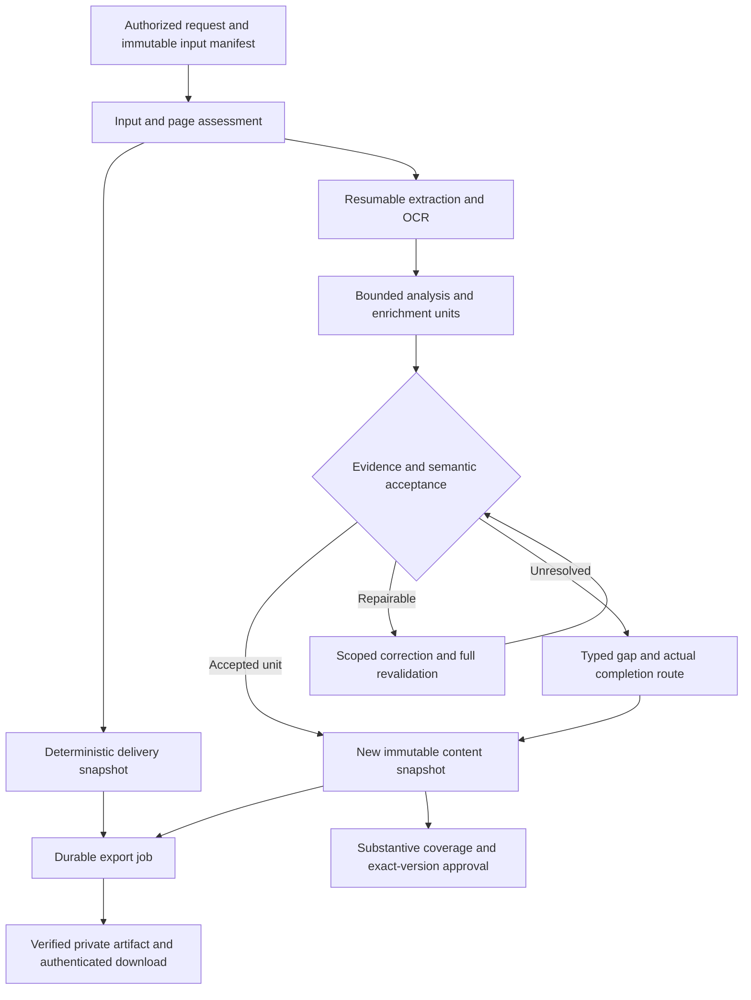
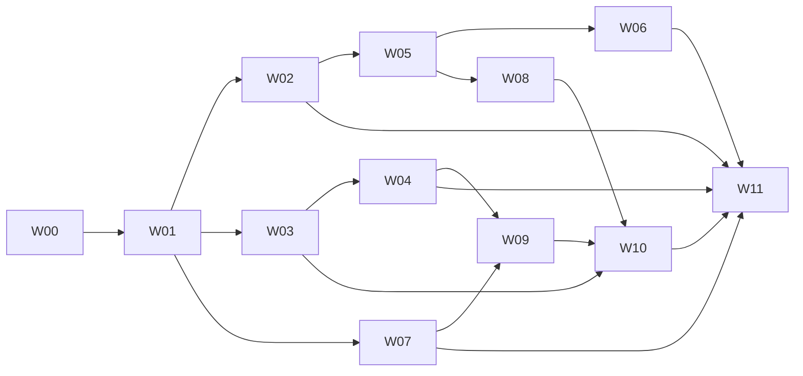

# خطة إصلاح موثوقية العروض والتحقق من إغلاق جميع الفجوات

التاريخ: 4 نوفمبر 2026. الحالة: **خطة مطلوبة من المالك؛ التنفيذ والقبول التشغيلي لم يكتملَا**.

نسخة المصدر التي بُنيت عليها المراجعة: `bd409896aa356cb6a5d9f73aee7ef202152f1b69`، وشجرتها
`51a6cac929648a93369a3314a8d0efce39ee1a1b`، المطابقة للمصدر المراجع `953a1045`.
هذه نقطة بدء موثقة، وليست ادعاءً بأن بيئة الإنتاج لم تتغير بعدها.

الغرض هو معالجة **كل الفجوات F01–F11** في المراجعة الهندسية، وإثبات أن طلب تقديم عروض
(Request for Proposal — RFP) صالح ينتج عرضًا مفيدًا يمكن تنزيله، وأن المدخل الفارغ أو غير
الصالح تمامًا ينتج قالبًا بمواضع تعبئة (Placeholders) صفراء وتنبيه صحيح لعدم كفاية المعلومات.
لا تُغلق مشكلة بوجود تعديل في الكود وحده أو نجاح استجابة مزود النماذج.

هذه الوثيقة هي خطة التنفيذ. [خطة القبول التفصيلية](RELIABLE_PROPOSAL_ACCEPTANCE.md)
تحدد طريقة التجربة والحكم على النتيجة، و[سجل التنفيذ](IMPLEMENTATION_CHECKLIST.md)
يبقى مرجع الحالة الفعلية. سجل العمل الأولي في آخر هذه الوثيقة كله مفتوح.

## 1. المرجعية وما لا يجوز افتراضه

1. تستكمل هذه الخطة [خطة تنفيذ النماذج](MODEL_EXECUTION_PLAN.md)، و[خطة اتساق العرض والأداء](PROPOSAL_PERFORMANCE_PLAN.md)،
   و[القرارات المسجلة](DECISIONS.md). تظل الحالات MAIN-01–14 وE2E-01–10 مطلوبة؛ لا يستبدلها اختبار مصغر.
2. تعليمات المالك الحالية تحدد سلوك التسليم الجديد. قرارات 31 أكتوبر تسمح بالبدء من المراجع غير الكاملة
   دون اختلاق سلطة للمشتري. مرجع غير ذي صلة مع إشعار مناقصة أو مصدر آخر صالح لا يبرر قالبًا فارغًا.
3. قرارات 19 أكتوبر ألغت السقوف اليومية التطبيقية لاستدعاءات النماذج والتوكنات في التوجيه التلقائي.
   **لا تعيد هذه الخطة تلك السقوف، أو شرط إقرار الفوترة، أو حظرًا عالميًا بسبب استهلاك مجهول**.
   تبقى حدود الطلب الواحد، وصلاحيات المحتوى، وحدود التصحيح المثبتة، ومنع تكرار الطلب الملتبس.
   حدود التجربة المعزولة تحمي التجربة فقط؛ لا تصبح سياسة منتج خفية.
4. أدلة 3 نوفمبر عن توقف العرض وعدم وجود نسخة قابلة للتصدير هي أدلة تاريخية. تُقرأ حالة الإنتاج
   الفعلية قبل أي تنفيذ أو استعادة؛ لا تستخدم معرفات أو مراجعات قديمة لإجراء كتابة جديدة.
5. المراجعة السابقة شغلت 140 اختبارًا موجودًا وأعادت فحص خطأ الاقتباسات. هذا ليس قبولًا للمسار المقترح.
   مجموع اختبارات النشر السابق لا يثبت اكتمال عرض فعلي أو صحة كل معنى.
6. لا تُفترض مدة تسليم، أو سعة، أو تكلفة، أو نموذج متاح، أو دقة دلالية، أو فريق تحرير بديل.
   يسجل القسم 8 كيفية إثبات كل قيمة قبل الاعتماد عليها؛ غياب الإثبات يبقي شرط الإغلاق مفتوحًا.
7. تنفذ التغييرات على التطبيق الحالي في DigitalOcean والمستودع نفسه، بإضافات متوافقة.
   لا تبديل سحابة أو إطار تنسيق، ولا إعادة إنشاء بيانات، ولا رفع بيانات عميل إلى المستودع العام.

## 2. عقد النتيجة الذي يجب تنفيذه

### 2.1 النتائج المسموح بها

| الحالة المثبتة | نتيجة التسليم | شرط الصدق والاكتمال |
| --- | --- | --- |
| RFP صالح ومقروء | عرض خاص بالمناقصة، يشمل استجابة فعلية للنطاق وأجزاء موثقة محفوظة تدريجيًا | لا يُعد هيكل عناوين أو نسخ المصدر عرضًا مكتملًا؛ تقاس جودة الاستجابة والتغطية مستقلتين |
| RFP صالح مع نقص بيانات الشركة أو الأسعار | عرض بالمحتوى المتاح وحقول ناقصة محددة بالأصفر | لا يُختلق سعر أو شهادة أو شخص أو قدرة؛ لا يتحول المجهول إلى صفر |
| مصدر صالح مع تعطل نموذج أو مراجع | مسودة بالمحتوى المقبول، وأسباب المعالجة المتأخرة، ومسار استكمال فعلي | لا يُسمى المصدر غير صالح، ولا يُحسب الناتج الناقص عرضًا مكتملًا |
| صفحات مقروءة وأخرى تحتاج معالجة | الاحتفاظ بكل جزء مقروء مع سجل تغطية للصفحات | التعرف الضوئي على الحروف (Optical Character Recognition — OCR) يستكمل الصفحات المتبقية؛ لا تدّعي قراءة ما لم يُقرأ |
| فارغ أو تالف أو غير قابل للاستخدام، ولا توجد مادة نطاق صالحة أخرى | قالب محفوظ دون حقائق مخترعة، وكل مواضع التعبئة صفراء | تنبيه لعدم كفاية المعلومات، مع السبب المحدد؛ فشل القراءة التقني لا يثبت فساد متطلبات المشتري |
| انقطاع شامل للخدمة أو فقدان التفويض | حادث تشغيلي صادق واستعادة مضبوطة؛ لا نجاح تنزيل كاذب | لا يُحوّل الانقطاع إلى مشكلة RFP، ولا يُكشف ملف لغير المصرح له |

الملف الممسوح الصحيح الذي تعذرت قراءته قد ينتج مخرجًا مؤقتًا من السياق المتاح؛ **لا يغلق ذلك
التزام استكمال العرض الصحيح**. يستمر مسار القراءة أو الاستكمال البديل حتى تحقق شرطه.

### 2.2 حالات مستقلة

الأسماء التالية تصميم مستهدف، وتُثبت العقود النهائية في الحزمة W01 قبل إنشاء ترحيل:

- `input_assessment`: سلامة الملف، ملاءمة المصدر، سلطة الجهة المصدرة، تغطية الاستخراج وكفاية المعلومات.
- `delivery_state`: طلب محفوظ، نسخة جاهزة، إنشاء ملف جارٍ، ملف متاح، استعادة تسليم أو حادث.
- `enrichment_state`: تقدم وحدات النماذج أو انتظارها أو توقفها أو إلغاؤها؛ لا تُغير إلى ناجحة لإتاحة ملف.
- `content_state`: هل توجد استجابة فعلية كافية؟ ما النواقص والادعاءات غير المقبولة؟ حصر البنود في قائمة نواقص لا يثبت الاكتمال.
- `approval_state`: مسودة أو مراجعة أو اعتماد مربوط بنسخة وأدلة محددة، مع الإبطال عند التغير.
- حالة الاستهلاك المالي تبقى في دفترها الحالي؛ لا تتحول إتاحة الملف إلى تسوية محاسبية.

### 2.3 ثوابت لا يسمح لأي إصلاح بكسرها

1. لكل طلب مقبول ومصرح به سجل تسليم دائم ومسار تجميع لا يحتاج نجاح نموذج.
2. لا تُرقى نتيجة مرفوضة إلى حقيقة أو بند إلزامي لإكمال الملف.
3. مصدر غير مؤكد السلطة لا يُنشئ التزامًا مؤكدًا للمشتري. نقص دليل قدرة الشركة لا يُضعف التزامًا ثابتًا في RFP.
4. كل اقتباس مربوط بإصدار مصدر وبصمته وموضعه؛ صحة وجود النص وصحة معناه فحصان منفصلان.
5. التكرار أو إعادة تشغيل العامل لا يضاعف النسخ المنطقية أو الطلبات المدفوعة الملتبسة.
6. لا تكتب نتيجة متأخرة فوق تعديل المستخدم أو ملحق أحدث أو خطة ملغاة.
7. صلاحيات العضوية والمحتوى وبصمات المصدر والاعتماد تبقى مطبقة عند التجميع والنشر والتنزيل.
8. كل موضع تعبئة له سبب مقروء وتمثيل بيانات وتظليل أصفر فعلي؛ حذف العبارة المرئية لا يحل النقص.
9. الملفات الفنية والمالية المطلوبة تنتمي إلى لقطة واحدة؛ اكتمال ملف واحد لا يعني اكتمال الحزمة.
10. لا تُغلق فجوة إلا بمراجعة الكود واختبارات مناسبة وإثبات نشر وقبول فعلي حيث يلزم.

## 3. سجل الفجوات والتغطية الملزمة

المراجع تشير إلى الكود الحالي؛ التغييرات المستقبلية تحتاج إلى تحديث المرجع، لا تعديل وصف الماضي.

| الفجوة | الدليل الحالي | العمل المطلوب | القبول الرئيسي |
| --- | --- | --- | --- |
| F01 النسخة الأولى تتطلب اكتمال كل المراحل | [advance_generation](../supabase/migrations/20261015181000_persistent_generation.sql#L165)، [PendingProposal](../../frontend/src/components/PendingProposal.tsx#L107) | W01، W03، W04، W10 | T01، T06، T07، T11 |
| F02 المدخل الفارغ لا يصل إلى قالب محفوظ | [استخراج الملف](../../frontend/src/lib/documentExtraction.ts#L10)، [إقفال المدخل](../supabase/migrations/20261031202143_flexible_proposal_input_drafts.sql#L14) | W01–W04 | T03، T05 |
| F03 القراءة الجزئية تستبعد المستند المقروء جزئيًا، ومسار OCR للرفع غير مثبت | [الصفحات](../../frontend/src/lib/documentExtraction.ts#L37)، [لقطة المصادر](../supabase/migrations/20261031202143_flexible_proposal_input_drafts.sql#L39) | W02، W05 | T04، T05، T12 |
| F04 أسباب الإدخال والتشغيل لا تحقق عقد التسليم الجديد | [حدود الاستخراج](../../frontend/src/lib/documentExtraction.ts)، [تقسيم السياق](../supabase/functions/_shared/generation.ts#L698) | W01، W02، W07، W09 | T03–T07، T14 |
| F05 تشخيص أول خطأ وإعادة كتابة النتيجة كاملة | [validateQuotes](../supabase/functions/_shared/model.ts#L259)، [produce](../supabase/functions/_shared/modelGraph.ts#L839) | W05، W06 | T08، T09، T19 |
| F06 غياب عقد سلطة وإلزام وتغطية دلالية كاملة | [analyze_chunk](../supabase/functions/_shared/modelSchemas.ts#L98)، [سياق التحقق](../supabase/functions/_shared/modelGraph.ts#L132) | W05، W06، W08 | T01، T09، T16، T19 |
| F07 التصدير بالمتصفح والتظليل النصي والحصص وهوية التكرار | [connectedExport](../../frontend/src/lib/connectedExport.ts)، [renderDocx](../../frontend/src/lib/renderDocx.ts#L44)، [export.prepare](../supabase/migrations/20261015195000_export_authorization.sql#L72) | W01، W03، W04، W09 | T11–T15، T20 |
| F08 إعادة المحاولة بلا مخرج تسليم؛ تعارض بعض حواجز الاستعادة مع سياسة الاستهلاك التلقائية | [recover_processing_job](../supabase/migrations/20261019085418_autonomous_processing.sql#L173)، [حاجز الإصلاح](../supabase/migrations/20261102231710_writer_handoff_usage_blocker.sql#L12) | W03، W07، W09، W10 | T06، T07، T10، T17، T18 |
| F09 ستة مصادر بتطابق لفظي ومقاطع محدودة قد تفوّت أدلة الشركة | [relevant/snippet](../supabase/functions/_shared/generation.ts#L68)، [سياق الصياغة](../supabase/functions/_shared/generation.ts#L229) | W08 | T01، T02، T16 |
| F10 نفاد الحصة 403 يظهر كخطأ اعتماد | [تصنيف الخطأ](../supabase/functions/_shared/model.ts#L1258) | W07، W09 | T06، T10، اختبارات ME الخاصة بالمزود |
| F11 الصيانة غير الحرجة قد تمنع استلام العمل | [worker](../supabase/functions/worker/handler.ts#L43) | W09 | T07، T17، T18 |

يشمل F06 أيضًا: فصل معالجة الكتل عن استيعاب كل الالتزامات، الحقول المنطقية والرقمية في **جميع**
مهام التحقق، الشروط والنفي والاستثناءات وأسبقية الملاحق، وخطر خطأ الكاتب والمراجع المتشابه.
ويشمل F08 الاستعادة المقيدة للهويات التاريخية؛ نشر تعليمات جديدة وحده لا يصلح طلبًا قديمًا مثبتًا.
لا يسمح إغلاق العنوان بترك هذه البنود الفرعية دون دليل.

## 4. التصميم الذي ستنفذه الحزم



قاعدة البيانات تبقى صاحبة الطابور وحجوزات التنفيذ. لا تُضاف حلقة إعادة محاولة مستقلة تنافسها.
إنشاء Word عمل حتمي (Deterministic processing). يثبت W04 تشغيل مكتبة الإنشاء الحالية على الخادم
أو المسار المتوافق معها قبل اعتماد التصميم؛ لا يفترض أن نقل العامل من المتصفح يكفي وحده.

## 5. حزم التنفيذ والاعتماديات

كل حزمة تنتج طلب دمج (Pull request — PR) قابلًا للمراجعة، واختبارات العيب قبل التصحيح حيث ينطبق،
وتحديثًا لسجل التنفيذ. الأدوار أدناه مسؤوليات عمل مقترحة، وليست أسماء أشخاص أو توفرًا مفترضًا.

### W00 تثبيت الحالة وخط الأساس

**المسؤول:** قائد التنفيذ وضمان الجودة. **الاعتماديات:** لا شيء.

- احفظ نسخة المصدر، وبصمات صور واجهة برمجة التطبيقات (Application Programming Interface — API)
  والعامل والواجهة، وسجل الترحيلات وصلاحياتها، وعقود المهام ومساراتها الفعلية.
- اقرأ حالة الطلب المستهدف قراءة خاصة: المدخلات والإصدارات والمخرجات المقبولة والطلبات البعيدة والاستهلاك.
  احتفظ بالمعلومات الحساسة خارج GitHub؛ سجل عام منزوع التفاصيل يربط الأدلة ببصماتها.
- حوّل كل خطأ مثبت إلى حالة اختبار معزولة، بما فيها أربعة اقتباسات يُصلح منها ثلاثة، وبند ذو اقتباس صحيح وسلطة غير مؤكدة.
- ثبّت قائمة المهام من السجل البرمجي الفعلي، والاختبارات الحالية، والترحيلات النهائية، وجدول الاستعادة في W07.
- سجل القيم المفتوحة D01–D07 في القسم 8، والقياس أو البرهان المطلوب لحسمها.

**الإغلاق:** سجل خط أساس قابل لإعادة الإنتاج، ومصفوفة F/T كاملة، وحالات تكشف السلوك المعيب قبل تغييره.
لا ينفذ هذا العمل إعادة تشغيل أو استدعاء نموذج بمجرد الفحص.

### W01 عقود الإدخال والتسليم والنقص والنسخ

**المسؤول:** هندسة الخلفية والمنتج. **الاعتماديات:** W00.

- عرّف عقودًا ذات إصدارات في `contracts.ts` والأنواع المشتركة للأبعاد المذكورة في 2.2؛ افصل `partial` عن `invalid`.
- عرّف موضع التعبئة: معرف ثابت، مسار الحقل، السبب، النص المترجم، مراجع الأدلة، المسؤول عن توفير المعلومة، وأثره على الاعتماد.
  الأسباب تفرق بين نقص المصدر ونقص دليل الشركة والتعارض وتأخر OCR والمزود والمراجعة.
- عرّف لقطة التسليم (Delivery snapshot): هوية الطلب، المراجعة المتوقعة، بصمات المدخلات، تغطية الصفحات، المحتوى المقبول،
  النواقص، اللغة، قواعد الأجزاء، وإصدار القالب والتحقق. الحفظ غير قابل للتعديل؛ الإصلاح ينشئ خليفة.
- احسم علاقة اللقطة بـ`proposals.active_version_id` و`generation_plans.base_version_id` قبل الترحيل:
  إما مؤشر تسليم مستقل، أو عقد بإصدار جديد يميز نسخة الأساس عن النسخة المتاحة. إنشاء مسودة مبكرة
  لا يجوز أن يجعل خطة التوليد نفسها قديمة أو يستبدل عرضًا سابقًا معتمدًا تلقائيًا؛ يثبت الاختيار باختبار قاعدة بيانات.
- حدد من يملك إنشاء المسودة وتنزيلها وتجديدها وفق الأدوار الحالية. لا تضف موافقة محتوى منفصلة للعمل الذي يصرح به الطلب أصلًا.
- أضف ترحيلات تراكمية، وسياسات الأمن على مستوى الصفوف (Row-Level Security — RLS)، وسجل تدقيق،
  ومفتاح منع تكرار الأثر (Idempotency key) مرتبط بالطلب ومحتواه؛ لا تعِد تفسير السجلات السابقة.
- افصل دليل «كل البنود محسوبة» عن «كل البنود مجاب عنها بما يكفي» وعن «معتمد».

**الإغلاق:** اختبارات عقود وقاعدة بيانات طُبقت عليها الترحيلات فعليًا، أدوار مسموحة وممنوعة، وتزامن وإعادة طلب؛
لا تسمح حالة نجاح التسليم بترقية محتوى أو اعتماد.

### W02 إصلاح الإدخال والقراءة الجزئية وOCR

**المسؤول:** هندسة الوثائق. **الاعتماديات:** W01.

- استبدل جاهزية المستند الثنائية بسجل صفحة أو كتلة: مقروءة، فارغة مثبتة، تحتاج OCR، فشل استخراج، مرفوضة لأمان الملف.
  احتفظ بكل النصوص المقروءة؛ الصفحة الفارغة الفاصلة لا تستبعد بقية RFP.
- أضف مسار عمل دائمًا للمستندات المرفوعة، مستفيدًا من أجزاء OCR الحالية بعد إثبات ملاءمتها للملفات الخاصة.
  حدّد هوية الأصل والصفحة وبصمة النص وإصدار الاستخراج؛ يحترم إعادة التشغيل والإلغاء والصلاحيات.
- الملف الصفري أو التالف يبقى مرفوضًا كدليل؛ أمر قالب مستقل ومصرح به يحفظ سبب الرفض دون تزوير وثيقة أو نص.
- حافظ على فحوص التوقيع والأرشيف والمحتوى النشط. الحجم أو عدد الصفحات خارج السعة هو حد معالجة، لا حكم فساد RFP.
- بعد وصول OCR أو ملحق جديد أنشئ لقطة لاحقة؛ لا تغير المصدر الذي بني عليه ملف سبق تنزيله.

**الإغلاق:** T03–T05 وT12. يتضمن البرهان PDF نصيًا بصفحة فارغة، ومختلطًا، وممسوحًا، وملفًا تالفًا،
ونصًا عربيًا. تحفظ كل صفحة مقروءة ويظهر كل جزء لم يُقرأ، ثم ينجح مسار رفع خاص إلى نص موثق.

### W03 تجميع مسودة مبكرة وحفظ التقدم

**المسؤول:** هندسة التوليد والخلفية. **الاعتماديات:** W01؛ تكامل W02 مطلوب قبل إغلاقه.

- أضف أمرًا ذريًا لتجميع أول نسخة من مصادر مسموحة وهيكل معتمد دون نجاح `analyze_chunk` أو المراجع.
  أنشئه عند قبول الطلب أو اكتمال فحصه المحدود؛ لا تجعل نجاح جميع أجزاء OCR شرطًا لإتاحة المحتوى المقروء.
- للمدخل الصالح استخدم بيانات المناقصة ونطاقها المقروء والمحتوى المقبول. ما لم يُحلل يبقى مقطعًا غير مصنف؛
  لا يتحول تلقائيًا إلى متطلب إلزامي. المخرج الأولي ليس قبولًا تلقائيًا لاكتمال العرض.
- رقّ المخرجات المقبولة على مستوى الوحدة إلى نسخة خليفة؛ احتفظ بالجيدة عند فشل وحدة أخرى.
  لا يدخل المرشح المرفوض في الملف كحقيقة، ولا يعاد استهلاك الكاتب من أجل إعادة التجميع.
- ضع سياسة تعارض صريحة: تحقق المراجعة وبصمة المصدر؛ عند تعديل المستخدم أو تغير الملحق تُرفض الكتابة المتأخرة
  أو تُحوّل إلى مقترح مراجعة. لا دمج بالعنوان وحده، ولا إعادة اعتماد تلقائية.
- اختبر نشر أول لقطة ثم ترقية وحدة لاحقة مع استمرار الخطة نفسها؛ لا يُعامل تغير مؤشر التسليم المصرح به
  كتعديل مستخدم، ولا يُستخدم ذلك لاستثناء تعديل مستخدم حقيقي من فحص التعارض. تبقى النسخة المعتمدة السابقة محفوظة.
- وفّر تنزيل المسودة في حالة الانتظار والتوقف، وأبقِ حالة الإثراء وأسبابه ظاهرة. الإلغاء يوقف العمل المستقبلي
  ويحفظ النسخ المسموح بها؛ النتيجة المتأخرة تسوّي الإيصال ولا تنشر نفسها.
- أضف إنقاذًا موثقًا للأجزاء المقبولة من الخطط القديمة، مستقلًا عن أوامر إعادة استدعاء النماذج.
- الاحتفاظ بجزء مقبول تاريخيًا يحفظ معه مصدره وإصدارات التعليمات والمخطط والمراجع ودليل قبوله الأصلي.
  لا يُعرض كأنه اجتاز ضوابط السلطة والمعنى الجديدة؛ يمر بعملية تحقق خليفة صريحة، أو تبقى حالة ضمانه
  التاريخية وحدودها ظاهرة وتمنع ادعاء الجاهزية الجديدة. حداثة المصدر وحدها لا تثبت صحة الدلالة.

**الإغلاق:** T01 وT02 وT06 وT07 وT10–T12 وT15 وT20؛ سجل نسخة وبايتات قابلة للتنزيل تحت فشل كل مرحلة.
يبقى شرط المحتوى الجوهري في W10 مفتوحًا حتى يوجد مسار استكمال مثبت.

### W04 تصدير دائم على الخادم وحزمة قابلة للاسترجاع

**المسؤول:** هندسة التصدير والتشغيل. **الاعتماديات:** W01 وW03؛ نموذج تشغيل مثبت في D02.

- احتفظ بنموذج المحتوى المصرح به ومكتبة Word الحالية حيث تثبت ملاءمتها؛ انقل الإنشاء إلى وظيفة دائمة بخطوط محلية مثبتة.
  لا تعتمد على تبويب مفتوح أو تحميل الخطوط من متصفح العميل.
- ثبت مراحل `requested → rendering → stored → verified → available` ومعالجة الاستئناف عند كل حد.
  هوية التصدير تشمل مساحة العمل وبصمة النسخة واللغة والقالب والمُنشئ والنمط والجزء؛ لا إعادة استخدام عبر المستأجرين.
- ابدأ بمفتاح ثابت للعمل المنطقي؛ احفظ الملف وبصمته وحجمه، وعالج نجاح الرفع وفشل تثبيت قاعدة البيانات والعكس دون نشر مزدوج.
- تحقق من تطابق النص ومن بنية Word ومن تظليل كل موضع تعبئة فعليًا. لا يكفي تطابق النص وحده.
  تحقق من الفقرات والجداول واتجاه العربية والأرقام وعدم تسرب السعر إلى الجزء الفني.
- سجل اكتمال الحزمة والأجزاء منفصلين؛ عند فشل الجزء الثاني يستأنف من النسخة نفسها دون إعادة الجزء الأول أو إعلان اكتمال الحزمة.
- أعد تنزيل البايتات الجاهزة بعد تحقق صلاحية حالي، دون حجز إنشاء جديد لكل ضغطة. راجع حدود الطلبات والسعة
  بقياس وحجز موارد ومسار استعادة؛ لا تلغِ الحدود عشوائيًا ولا تُخفِ فشل التخزين.
- حدّث واجهات قائمة العروض والمحرر والتصدير والحالة. أضف قابلية الاستخدام بلوحة المفاتيح ورسائل عربية وإنجليزية.
- **طوّر أداة القبول الموجودة** التي تشترط `plan.status=completed` إلى عقد ذي إصدار مستقل للمسودة المبكرة؛
  احتفظ بفحوص الجلسة والمصدر والنسخة والبصمات، وبمسار قبول العرض المكتمل الحالي دون تخفيفه.

**الإغلاق:** T03 وT11–T15 وT20؛ إغلاق المتصفح وموت العامل عند كل حد ثم تنزيل مطابق،
وفحص صفحات الملفات العربية والإنجليزية. تحديث حقول الفهرس وأرقام الصفحات يُثبت بالمُنشئ المستهدف أو تبقى مراجعته موضحة.

### W05 مراجع مصدر حتمية وسلطة المتطلبات

**المسؤول:** هندسة الأدلة وعقود النماذج. **الاعتماديات:** W01 وW02.

- أنشئ معرفات مقاطع (Source spans) ثابتة مرتبطة بالأصل والصفحة والكتلة والبصمة وإصدار الاستخراج.
  عرّف وحدة الإزاحة صراحة، واختبر Unicode والتطبيع والمسافات واتجاه العربية وخريطة الرجوع للنص الأصلي.
- يختار النموذج مقطعًا أو عدة مقاطع منفصلة؛ يستخرج الخادم الاقتباس. لا يُعتمد نص اقتباس يعيد النموذج كتابته.
  المقطع القديم أو الخارج عن الحدود أو الذي يختلف مصدره يُرفض.
- أضف للمتطلب سلطة المصدر، وصيغة الإلزام، والفاعل، والنفي، والشروط والاستثناءات، والأرقام ووحداتها،
  وأسبقية الملحق. يبقى غير المؤكد غير مؤكد؛ الحقل الجديد وحده لا يثبت صحة تصنيف النموذج.
- ميّز حقيقة المشتري وحقيقة الشركة والمقترح التصميمي والافتراض والنقص، مع قواعد تمنع تحويل المثال أو عرض المورد
  إلى التزام مثبت للمشتري. احتفظ بنص المتطلب الأصلي عند تفسيره.
- احفظ سياق الجداول والعناوين والحواشي وعلاقة الكتل؛ افحص التعارض والإسقاط عبر حدود التقسيم.
- طبّق إصدارًا جديدًا على العمل الجديد؛ لا تعِد بناء هويات طلبات تاريخية من نص معدل.

**الإغلاق:** T08 وT09 وT12 وT16 وT19 مع المقارنة الذهبية البشرية، ورفض الاقتباس الصحيح إذا عكس المعنى.

### W06 تشخيص شامل وإصلاح محدد النطاق وتحقق كامل

**المسؤول:** هندسة تنفيذ النماذج وضمان الجودة الدلالية. **الاعتماديات:** W05؛ يمكن إثبات جمع الأخطاء قبل تغيير صيغة المقاطع.

- اجمع كل الأخطاء المحلية المستقلة في مرور محدود؛ ترتيب ثابت حسب الحقل؛ سجل العدد المستبعد وسبب الحد.
  إذا تجاوزت الأخطاء الحد، تستكمل الحزم التالية دون إخفاء الخطأ أو إعلان الصلاحية.
- استبدل طلب إعادة كتابة الكائن كاملًا بعقد تعديل محدد: بصمة المرشح، المسارات المسموحة، السبب، وقيم بديلة موثقة.
  يطبق الخادم التعديل ويرفض المسارات غير المصرح بها ثم يعيد التحقق من الكائن كاملًا.
- إذا تطلب إصلاح المعنى تعديل حقول مترابطة، وسع النطاق في مرشح جديد مع السبب والاعتماديات؛ لا تجمّد خطأ معلومًا
  لمجرد تقليل الفرق، ولا تسمح بتوسعة صامتة.
- مرّر الحقول المؤثرة ذات الأنواع ومساراتها إلى المراجع في **كل مهمة**، وليس تحليل المتطلبات فقط.
  اختبر اختلاف قيمة منطقية أو رقمية أو null مع بقاء النص نفسه، وأثبت تغير المدخل المعروض للمراجع.
- سجل هوية الكاتب والمراجع ودرجة اختلافهما. لا تدّع استقلالًا عند الرجوع إلى النموذج نفسه.
  قائمة معرفات «تمت معالجتها» لا تكفي؛ اختبارات المعنى والتحقق الحتمي والمراجعة البشرية للحقائق الحرجة مستقلة.
- تبقى محاولات التصحيح محدودة ومثبتة. بعد الاستنفاد يعزل الجزء غير المقبول، ويستمر مسار الملف والاستكمال البديل.

**الإغلاق:** T08 وT09 وT19، وحالات ME المفصلة؛ كل حالة تنجح في اكتشاف خطئها وإصلاحه أو إبقائه غير مقبول،
ولا تغير التزامًا أو رقمًا خارج النطاق ولا تخفي عيبًا باستنفاد حد التشخيص.

### W07 تصنيف المزود والمحاسبة والاستعادة التاريخية

**المسؤول:** هندسة الموصلات والخلفية. **الاعتماديات:** W00 وW01؛ اختبار التكامل مع W03 وW06.

- طبّع الأخطاء من الحالة والرمز والسبب: حصة نموذج، حصة حساب، حد مؤقت، اعتماد خاطئ، إذن مرفوض، نموذج غير متاح،
  نقل ملتبس، طلب غير صالح، محتوى غير صالح، وطلب بعيد منتهٍ. لا تستنتج من 403 وحده سببًا واحدًا.
- اربط التهدئة بالنطاق المثبت: نموذج أو اتصال أو حساب؛ لا تتجاوز حد الحساب بالتبديل إلى نموذج آخر على الحساب نفسه.
  عند حصة نموذج فقط لا تعطل نموذجًا سليمًا يشاركه الاتصال. لا تفعل فوترة أو تغير free-only تلقائيًا.
- **عالج التعارض المحدد مع سياسة 19 أكتوبر:** قبول الناتج الصحيح تلقائيًا مع استعمال غير مبلغ عنه موجود في
  `model.ts`، بينما `retry_one_generation_job` وحاجز writer handoff قد يحجبان الاستعادة بلا انتهاء عند استهلاك مجهول.
  اختبر الحالات الفعلية، وطبّق انتقالًا مقيدًا متوافقًا مع السياسة، مع هوية محاولة جديدة واضحة عندما يسمح باستدعاء جديد.
  لا تحذف الإيصال ولا تصفّر الاستهلاك ولا تتجاوز ميزانية التصحيح المتبقية ولا تعيد POST لطلب نشط ملتبس.
- فرق بين طلب بعيد نشط، وطلب منتهٍ واستهلاكه غير معروف، ومرشح صحيح، ومرشح مرفوض؛ زوال الحاجز المالي لا يصلح المحتوى.
  يسجل قرار الاستعادة وأسبابه قبل التنفيذ، ويظل تجميع الملف مستقلاً عنه.
- أنشئ جدول استعادة لكل حالة تاريخية: طلب جارٍ مثبت، مرشح صحيح وتقرير خاطئ، مرشحون متعددون، مصدر تغير، إذن سُحب،
  استهلاك مجهول، وخطة ملغاة. لكل حالة عملية مسموحة ودليل وأثر متوقع وحدود وتراجع.
- لا تعمم أمر recheck المحدود بإزالة شروطه؛ أضف عملية خليفة ذات إصدار عند الحاجة، بمراجعة مستقلة وسجل نسب للمحاولات.

**الإغلاق:** T06 وT10 وT12 وT15 وT18 وحالات ME الخاصة بالتوجيه والتاريخ؛ تثبت اختبارات قاعدة البيانات
الحفاظ على الإيصالات والمخصصات والأذونات، وتختبر مساري التوجيه التلقائي واليدوي منفصلين.

### W08 استرجاع الأدلة وتغطية الاستجابة واتساق العرض

**المسؤول:** هندسة المعرفة وجودة المحتوى. **الاعتماديات:** W05؛ تكامل مع W03 وW06.

- استبدل افتراض كفاية أول ستة مصادر ومقطع 2,000 محرف باختيار أدلة مرتبط بكل متطلب، ضمن سعة السياق الفعلية.
  استخدم كل الأدلة إن كانت محدودة؛ وأثبت الحاجة إلى استرجاع دلالي قبل إضافة منصة أو مخزن جديد.
- اختبر الترادف والعربية مقابل الإنجليزية والمصدر السابع والنص المهم المتأخر والتساوي في الترتيب.
  إذا استُبعدت أدلة للسعة سجّل نقص التغطية وفعّل استرجاعًا موجّهًا؛ لا تحكم بغياب قدرة الشركة لمجرد عدم استرجاعها.
- حافظ على التوثيق والصلاحيات والحداثة والفصل بين أسلوب عرض قديم ودليل قدرة حقيقي.
- اربط المصدر بالمتطلبات، والمتطلبات بأقسام الاستجابة، وافحص الأرقام والشروط والقرارات المشتركة بين الأقسام والملاحق.
  الرد الجوهري يحل النطاق؛ وجود نص طويل أو رابط أو سؤال عام لا يغلق البند.
- أبقِ الحسابات المالية في Decimal، والأسعار والعملة والضرائب والالتزامات مجهولة إلى أن تثبت؛
  لا تسمح للنموذج بإقرار عدم الانطباق أو الاعتماد نيابة عن المالك.

**الإغلاق:** T01 وT02 وT09 وT15 وT16 وT20، وتقييم مستقل للإسقاط والادعاءات والاتساق والاسترجاع.

### W09 عزل التشغيل وقياس التسليم والسعة

**المسؤول:** التشغيل وهندسة الطابور. **الاعتماديات:** W01 وW04 وW07.

- اجعل تسليم الملف فئة عمل محلية لا تحتاج خانة نموذج، بحصة تنفيذ مثبتة باختبار حمل دون تجويع بقية العمل.
- اعزل الصيانة والتنظيف والإشعارات غير الحرجة عن الاستلام؛ يبقى فحص التفويض وسلامة المصدر والسعة على المسار الصحيح.
  إخفاق الصيانة يسجل حادثًا واستعادة، لا يُبتلع ولا يمنع كل الوظائف بلا ضرورة.
- قِس وقت قبول الطلب، وأول لقطة، وأول بايت ملف متاح، واكتمال العرض، والانتظار لكل سبب.
  ضع هدف مستوى الخدمة (Service Level Objective — SLO) من القياس وحدود القبول، مع حجز سعة وتنبيه قبل الامتلاء.
- اعرض حالة الملف والإثراء والنواقص مستقلة؛ احتفظ بسجل آمن لهويات الطلبات والمزود والتعليمات، دون نصوص العملاء.
- اختبر الاستعادة إلى بيئة معزولة: الملفات والبصمات والصلاحيات، وعدم استئناف رسائل أو طلبات نماذج ملتبسة تلقائيًا.
  النسخة المنطقية وحدها لا تثبت استعادة DigitalOcean؛ يلزم تمرين فعلي وأهداف استعادة مقاسة.

**الإغلاق:** T07 وT11 وT14 وT17 وT18، وقيم D01 وD04 وD05 المثبتة. مؤشرات النجاح لا تستبعد الأعطال من مقام القياس.

### W10 استكمال العرض عند تعطل جميع النماذج

**المسؤول:** مالك المنتج وهندسة المحتوى والتشغيل. **الاعتماديات:** W03 وW05 وW08 وW09.

- أثبت مسارًا يستطيع إنتاج استجابة جوهرية ضمن النطاق المستهدف: محتوى ردود معتمد ذو ملاءمة وشروط استخدام موثقة،
  أو إدخال منظم مصرح به، أو محرر مسؤول فعليًا. لا تفترض وجود مكتبة أو موظف أو قدرة زمنية غير مثبتة.
- المحتوى المعاد استخدامه مقترح تصميمي فقط حيث يصدق؛ لا يحمل معه أسماء عميل أو أسعارًا أو شهادات أو التزامات قديمة.
- حدد متى يبدأ التصعيد وكيف يستلم المسؤول المصدر والأجزاء المقبولة والنواقص، وكيف تعود النتيجة عبر العقود نفسها.
- نفّذ تجربة فعلية مع حجب جميع مزودي النماذج في البيئة المعزولة حتى النهاية. لا تنهها بمجرد تنزيل الهيكل.

**الإغلاق:** T01 وT06 مع استجابة مقيمة فعليًا وموعد مثبت وإقرار مسؤول التشغيل بالقدرة.
إذا لم يُثبت مسار الاستكمال، **يبقى وعد العرض المكتمل مفتوحًا**؛ لا يُحذف هذا البند من الخطة أو يُخفّض إلى «الملف موجود».

### W11 القبول المتصل والنشر والتراجع

**المسؤول:** قائد الإطلاق ومراجع مستقل. **الاعتماديات:** كل الحزم السابقة وإغلاق قراراتها.

- نفذ مصفوفة الاختبارات في الوثيقة المرافقة، وأعد MAIN-01–14 وE2E-01–10 بالمدى المنطبق،
  مع تسجيل عدم انطباق أي حالة وسببه بدل تخطيها بصمت.
- افصل مسودة قابلة للتنزيل عن حزمة نهائية معتمدة. E2E-10 يحتاج حقائق وأسعارًا واعتمادًا حقيقيًا؛
  إن لم تتوفر تبقى هذه الحالة غير مقبولة دون منع اختبارات المسودة.
- انشر ترحيلات وعقودًا متوافقة أولًا، ثم API والعامل والمُنشئ والواجهة بنسخ متوافقة، وفعّل السياسة لطلبات محددة الإصدار.
- قبل النشر وبعده: بصمات المصادر والصور والترحيلات، صلاحيات الأدوار، سلامة الطلبات الجارية، وقراءة سجل النسخ الموجودة.
- نفذ تراجعًا تجريبيًا قبل الإنتاج؛ لا يحذف ملفات نُشرت أو إيصالات دفع أو يترك لقطة لا يقرأها الإصدار السابق.
- تحقق فعليًا من رفع RFP مصرح به إلى تنزيل Word من جلسة المستخدم، ومراجعة المصدر وكل صفحة،
  بما فيها اللغة العربية والإنجليزية والأجزاء الفنية والمالية. التقارير الخاصة لا تنشر في Actions أو GitHub.
- راقب الحالات الجديدة تحت حمل مقاس، ثم وسّع التفعيل بعد إغلاق المعايير؛ ظهور إخفاق حرج يعيد فتح الفجوة ويوقف التوسيع.

**الإغلاق النهائي:** جميع F01–F11 وبنودها الفرعية مغلقة بالدليل، T01–T20 ومتغيراتها مطابقة،
ولا حالة «غير مجرب» محسوبة نجاحًا. الاستقلال عن توافر النموذج يُثبت بعطل محقون؛ التوافر الحي يُثبت بمزود فعلي منفصلًا.

## 6. ترتيب التنفيذ وما يمكن تشغيله بالتوازي



يمكن بدء W03 باستخدام المدخلات المقروءة الحالية بعد W01، لكن لا يُغلق قبل تكامل W02.
يمكن تطوير جمع التشخيصات في W06 مبكرًا، وتبقى صيغة الإصلاح النهائية مرتبطة بـW05.
لا ينتظر إصلاح التصدير واستقلال المسودة انتهاء تحسين النماذج. لا يُعلن الوفاء الكامل بوعد المنتج قبل W10 وW11.
ترتيب العمل هنا اعتماديات، وليس تقدير مدة تنفيذ غير مقاس.

## 7. طريقة الاختبار والدليل المقبول

التفاصيل التنفيذية والمتغيرات في [RELIABLE_PROPOSAL_ACCEPTANCE.md](RELIABLE_PROPOSAL_ACCEPTANCE.md).

1. اكتب النتيجة المرجعية المستقلة (Test oracle) من المصدر قبل تشغيل النموذج؛ لا يستخدم الناتج المراد اختباره لكتابة إجابة الاختبار.
2. للحالات الدلالية: مراجع يحدد الحقيقة من المصدر ومراجع آخر يراجعها؛ يُحسم الخلاف قبل تجميد مجموعة التقييم.
   تعليمات النموذج لا تضبط على الجزء المحجوز للاختبار (Held-out set).
3. أظهر أن الحالة تكشف الخطأ في النسخة السابقة حيث ينطبق، ثم تثبت التصحيح والسلوك الممنوع.
   اختبار يعيد تنفيذ الخوارزمية نفسها دون حقيقة مستقلة لا يكفي.
4. ابدأ بفحوص وحدات حتمية ثم قاعدة بيانات مطبق عليها سجل الترحيلات ثم API وأدوار حقيقية في بيئة معزولة ثم متصفح وملف فعلي.
   PGlite وjsdom لا يثبتان Auth/Storage/RLS المستضافة أو جودة صفحات Word الفعلية.
5. حقن الأعطال (Fault injection) في بيئة الاختبار عبر واجهة النقل والساعة وحدود الحفظ؛ لا تعطل مزودًا أو مفتاحًا في الإنتاج للتجربة.
6. قبل تجربة نماذج حية ثبّت قائمة المهام والمسارات المتاحة وإصدارات التعليمات والحالات وحدود التجربة.
   يسجل كل فشل أولي وكل إعادة؛ لا تُعد المحاولات حتى ينجح نموذج ثم تمحُ الإخفاقات.
   تثبت أيضًا تغطية اللغات والمهام والنماذج، وحجم العينة المحجوزة، وسياسة التكرار وحدود القبول
   للأخطاء غير الحرجة قبل رؤية النتيجة وفق D07؛ لا يُختار الحد بعد معرفة النموذج الناجح.
7. غياب مفتاح أو نفاد حصة حالة غير مقيمة دلاليًا. يحظر حسابها جودة ناجحة أو إخفاؤها من التقرير؛
   تبقى تغطية ذلك المسار مفتوحة أو يُزال من نطاق التشغيل بقرار صريح موثق، لا تلقائيًا لإغلاق الخطة.
8. النتيجة الحاسمة للملف: نسخة ومصدر مثبتان، بايتات Word منزلة من جلسة مسموحة، بصمة وحجم مطابقان،
   مراجعة محتوى مقابل المصدر، وفحص بصري لكل صفحة. لقطة شاشة أو HTTP 200 وحدهما غير كافيين.
9. سجل لكل تجربة: commit، بصمات الصور والترحيلات، fixture/hash، اللغة، الدور، task/model/route، prompt/schema/policy versions،
   fault schedule، expected/actual، الحالات قبل وبعد، العدد الفعلي لـPOST/poll، الاستهلاك المعروف والمجهول،
   بصمة الملف وأجزائه، حالة التنظيف، رابط الإيصال الخاص وبصمته، واسم المراجع أو دوره المعين فعليًا.
10. كل assertion حرج في مجموعة القبول يجب أن ينجح؛ هذه قاعدة للعينات المحددة، وليست ادعاء دقة عالمية 100%.
    تقاس النتائج الاحتمالية بالأعداد وفواصل الثقة المناسبة ومعدلات الإخفاق حسب الفئة واللغة؛ لا يخفي المتوسط خطأ إلزام أو ادعاء مختلقًا.

### الأوامر الأساسية الموجودة

من جذر المستودع، بعد تثبيت البيئة المطلوبة؛ الاختبارات محلية ولا تحتاج مفاتيح إنتاج:

```sh
npm ci --prefix backend
npm ci --prefix frontend
npm --prefix backend run typecheck
npm --prefix backend test
npm --prefix backend run build
npm --prefix frontend run typecheck
npm --prefix frontend test
npm --prefix frontend run build
python3 -m unittest discover -s backend/scripts/ops -p 'test_*.py'
python3 -m unittest discover -s backend/deploy/kubernetes -p 'test_*.py'
```

لتشغيل ملف backend محدد، استخدم `npx vitest run tests/backend/<existing-file>.test.ts` من `backend/`؛
تمرير اسم الملف إلى `npm test` قد يُبقي نطاق `tests/backend` الموجود في الأمر ويشغل المجموعة كاملة.
أسماء الاختبارات الجديدة وأوامرها تُثبت عند إضافتها؛ لا تصف هذه الخطة ملفًا مقترحًا بأنه موجود.

## 8. سجل القرارات والأدلة الناقصة

هذه مسائل يجب حسمها بالأدلة أثناء التنفيذ؛ ليست افتراضات مرخصة ولا أسبابًا لترك المشكلة دون علاج.

| المعرف | ما لم يثبت بعد | طريقة الحسم والمسؤول | ما يتوقف عليه |
| --- | --- | --- | --- |
| D01 | زمن أول ملف وزمن استكمال العرض والسعة العملية | تشغيل ملفات صغيرة وكبيرة وعربية وإنجليزية ومختلطة مع تزامن مقاس؛ نشر توزيع الزمن والموارد؛ المنتج والتشغيل يثبتان الهدف وحدود الخدمة قبل اعتمادها | W09، W10، W11 |
| D02 | مكان تشغيل مُنشئ Word الحالي وتوافق الخطوط والفهرس | تجربة على صورة تشغيل معزولة من التقنية الحالية؛ مقارنة المحتوى والموارد والإعادة؛ اختيار العامل المناسب بالأثر المقاس دون خدمة مدفوعة مفترضة | تصميم نشر W04 |
| D03 | OCR للملفات الخاصة ودقة القراءة المقبولة | حصر الموصل المتاح والمصرح به، تجربة صفحات ذهبية ومقارنة النص والمواضع؛ منع إرسال الأصل إلى مزود جديد دون سياسة قائمة | W02، W05 |
| D04 | سعة التخزين والطلبات والاحتفاظ بالملفات | قياس أحجام النسخ والملفات والحصص الفعلية، محاكاة الامتلاء، تثبيت حجز أول ملف وإعادة التنزيل وسياسة تنظيف لا تحذف المطلوب | W04، W09 |
| D05 | أهداف ومدة استعادة البنية والملفات | تمرين استعادة في بيئة معزولة؛ تحديد نقطة الاستعادة (Recovery Point Objective — RPO) وزمنها (Recovery Time Objective — RTO) من متطلبات الخدمة والبرهان | W09، W11 |
| D06 | قدرة إكمال عرض جوهري دون أي نموذج متاح | إثبات محتوى معتمد مناسب أو محرر معين ومسار إدخال ووقت استجابة فعلي؛ لا إغلاق بإرسال قالب فقط | W10 والوعد التجاري النهائي |
| D07 | حجم مجموعة التأهيل وحدود الجودة الدلالية غير الحرجة | قائد ضمان الجودة ومراجع المجال يثبتان قبل التشغيل مصفوفة اللغة/المهمة/النموذج، حجم العينة والتكرارات، تعريف الاستجابة الجوهرية، وحدود الإسقاط والقبول الخاطئ والرفض الخاطئ وفواصل الثقة؛ تبقى الأخطاء الحرجة المزروعة مانعة للإطلاق دون متوسط يخفيها | W05، W06، W08، W10، W11 |

خلاف سياسة الاستهلاك المحدد في W07 يُحسم باتباع قرار المالك بالتوجيه التلقائي مع ضوابط الهوية
والمحاولات والصلاحيات؛ إذا كشف التنفيذ تعارضًا إضافيًا يؤثر في الالتزامات، يُسجل بالنص والبدائل
والأثر قبل تغييره. لا يحتاج العمل المستقل إلى انتظار حسم قيم قياس لا يعتمد عليها.

## 9. شروط الإغلاق ومنع الإغلاق الشكلي

لكل فجوة سجل واحد يربط `F → W → T/variant → code PR → test receipt → deployment → hosted acceptance`.
حالاته منفصلة: `not_started / implemented / locally_verified / deployed / hosted_verified / closed`.
فشل شرط أو غياب دليل يبقيه مفتوحًا؛ لا يكفي PR مدموج أو زيادة عدد الاختبارات.

| شرط الإغلاق | الإثبات الإلزامي |
| --- | --- |
| أصل المشكلة | مثال يكشف السلوك السابق أو برهان مسار/عقد موثق إذا تعذر إعادة العطل دون أثر إنتاج |
| صحة الإصلاح | فرق الكود، مراجعة مستقلة، اختبارات موجبة وسالبة، وحدود الحالة معروفة |
| عدم كسر وظائف أخرى | الاختبارات المناسبة ثم اختبارات الحزمتين وMAIN/E2E المنطبقة؛ أدوار وحسابات واعتماد وملفات قديمة |
| سلامة النشر | صور وترحيلات وعقود متوافقة، إثبات طلب جارٍ، تجربة رجوع تحفظ السجلات |
| نجاح العمل للزبون | ملف فعلي مطابق، محتوى مفيد، كل نقص ظاهر، لا اختلاق ولا ادعاء اكتمال أو اعتماد غير صحيح |
| الاستمرارية | عطل محقون، استئناف وتكرار وتزامن، سعة وقياس وتصعيد مثبتان |
| حالة المزود غير المتاح | تبقى غير مقيمة ومفتوحة لدور ذلك النموذج؛ لا تحويلها إلى نتيجة جودة ناجحة |

## 10. سجل العمل عند إنشاء الخطة

| الحزمة | التنفيذ | الاختبارات الجديدة | النشر | القبول التشغيلي |
| --- | --- | --- | --- | --- |
| W00 خط الأساس التنفيذي | لم يبدأ | مطلوبة | لا ينطبق على القراءة | لم يثبت خط أساس إنتاج جديد |
| W01 العقود | لم يبدأ | مطلوبة | لم ينشر | مفتوح |
| W02 الاستخراج وOCR | لم يبدأ | مطلوبة | لم ينشر | مفتوح |
| W03 المسودة المبكرة | لم يبدأ | مطلوبة | لم ينشر | مفتوح |
| W04 التصدير الدائم | لم يبدأ | مطلوبة | لم ينشر | مفتوح |
| W05 المقاطع والسلطة | لم يبدأ | مطلوبة | لم ينشر | مفتوح |
| W06 الإصلاح والتحقق | لم يبدأ | مطلوبة | لم ينشر | مفتوح |
| W07 المزود والمحاسبة والاستعادة | لم يبدأ | مطلوبة | لم ينشر | مفتوح |
| W08 الاسترجاع والاتساق | لم يبدأ | مطلوبة | لم ينشر | مفتوح |
| W09 التشغيل والقياس | لم يبدأ | مطلوبة | لم ينشر | مفتوح |
| W10 الإكمال دون نماذج | لم يبدأ | مطلوبة | لم ينشر | مفتوح |
| W11 القبول والإطلاق | لم يبدأ | مطلوبة | لم ينشر | مفتوح |

اكتمال **كتابة هذه الخطة وحفظها** لا يغير حالة أي صف إلى منفذ. كل متابعة لاحقة تحدث هذا السجل
وسجل التنفيذ بالأدلة، حتى آخر بند فرعي، دون إسقاط حالة تعثرت أو إعادة تعريف نجاحها.
